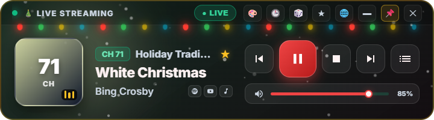
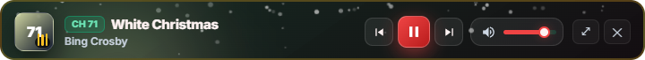
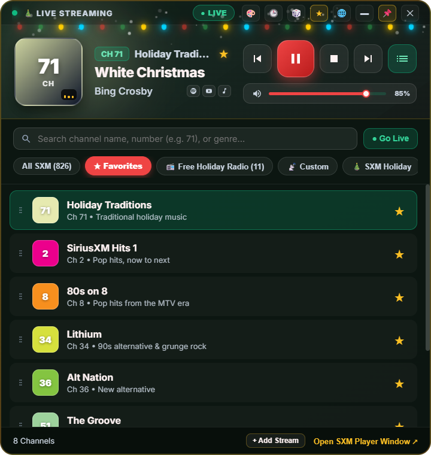

# SiriusXM Desktop Widget

A lightweight Windows desktop radio widget for SiriusXM built with Electron.

## Screenshots

### Compact Player


### Mini Bar Mode


### Channel Browser Drawer (Favorites & Custom Streams)


### Themes & Settings (Synthwave)


## Features
- **Compact Player & Mini Bar Mode:** Floating desktop widget with a one-click 68px single-row Mini Bar mode and proportional **S / M / L / XL** size presets
- **Expandable Channel Drawer:** Search by name, number, or genre, plus genre filter tabs, **Free Holiday Radio** streams, and full **SiriusXM Web Player** integration
- **Playback & Volume Controls:** Play/Pause, Stop, Previous/Next channel, **● LIVE** jump-to-live, and an in-widget **Volume Slider & Mute** toggle (with mouse-wheel support) synced across both SiriusXM and direct streams
- **Favorites with Drag-and-Drop Ordering:** Star channels, reorder your Favorites list by dragging, and toggle Favorites-only Prev/Next cycling
- **Direct Channel Number Entry:** Type any channel number (e.g. `71`, `W1`, `C1`) while focused on the widget for a car-radio-style HUD with live preview and **Enter** to tune
- **Custom Radio Streams & Playlists:** Add your own MP3/AAC/HLS (`.m3u8`) streams or `.pls` / `.m3u` playlist URLs right from the drawer (`+ Add Stream`) with custom badge codes, accent colors, and live **ICY / Shoutcast song titles**
- **Surprise Me (`🎲`):** Jump to a random channel within your active filter or Favorites
- **Recent Track History (`🕒`) & One-Click Lookup:** Logs the last 12 played tracks with relative timestamps, one-click copy (`Artist - Title`), and instant **Spotify / YouTube / Genius Lyrics** lookup buttons in both Now Playing and Track History
- **10 Built-in Themes:** Christmas, Blizzard, Thanksgiving, Pumpkin Spice, Autumn Woods, Hearth Gold, Midnight, Synthwave, NyQuil, and **🌈 Adaptive** (automatically tints the widget to match the current track's album art)
- **Visual, Audio & Reliability Polish:** Always-on-top pin mode, opacity dimmer (35–100%), **Mini Audio Visualizer** spectrum bars, music-reactive Christmas lights, **Stream Watchdog & Auto-Reconnect** (recovers dropped streams and auto-resumes SiriusXM inactivity prompts), **Backup / Restore** settings export/import, **Update Notifier**, remembered window position across restarts, and optional **Launch with Windows** startup toggle

## Installation

### Option 1: Download the Portable `.exe` (Easiest — No Node.js Required)
1. Go to the [**Releases**](https://github.com/de4d5y/sxm-widget/releases) page on GitHub.
2. Download `SiriusXM-Widget-1.1.0-Portable.exe`.
3. Double-click it to run — no installation or extra software required.
   *(If Windows SmartScreen shows a warning on first launch, click **More info → Run anyway**.)*

### Option 2: Run or Build from Source
**Prerequisites:** Windows 10 / 11 and **Node.js (LTS)** from [nodejs.org](https://nodejs.org/) (includes `npm`).

1. **Get the code** — either:
   - Click **Code → Download ZIP** on GitHub and extract the folder anywhere on your PC, **or**
   - Clone with Git:
     ```bash
     git clone https://github.com/de4d5y/sxm-widget.git
     cd sxm-widget
     ```
2. **Open a terminal in the project folder** (e.g., open the `sxm-widget` folder in File Explorer, click the address bar, type `powershell`, and press Enter).
3. **Install dependencies** (takes ~1 minute the first time):
   ```bash
   npm install
   ```
   *(If `npm` isn't recognized right after installing Node.js, close and reopen your terminal and try again.)*
4. **Run** with `npm start` (or double-click `launch_widget.bat`), or **build your own portable `.exe`** into `dist/` with:
   ```bash
   npm run build
   ```

## Usage
Start the widget using either method:
- Run `npm start` in the project folder, **or**
- Double-click `launch_widget.bat`

### First-Time Sign In
1. Click the **🌐** button in the top-right bar of the widget to show the built-in SiriusXM Web Player window.
2. Sign in with your SiriusXM account.
3. Click **🌐** again to hide the web player window in the background — your login session is saved locally in your Windows user profile (`%APPDATA%`), so you won't need to sign in every time.

### Controls
- **Album Art / Channel Badge:** Click to expand or collapse the channel browser drawer.
- **Volume Slider & Speaker Icon:** Drag or scroll your mouse wheel over the volume bar to adjust volume; click the speaker icon to mute/unmute.
- **Type a Channel Number:** While focused on the widget, type a channel number (like `71` or `W1`) and press **Enter** to tune directly (`Esc` to cancel).
- **★ (next to channel name):** Add or remove the current channel from Favorites.
- **★ (top bar):** Toggle Prev/Next buttons between cycling all channels vs. Favorites only. Drag items by their `⋮⋮` handle in the **★ Favorites** tab to reorder them.
- **● LIVE:** Jump back to the live broadcast if the stream falls behind.
- **🎨 (Themes & Settings):** Switch between all 10 themes (including **🌈 Adaptive**), adjust **Opacity**, toggle **Music-reactive Christmas lights**, pick a proportional **📐 Size (S / M / L / XL)**, or enable **🚀 Launch with Windows**.
- **🕒:** Open the **Recent Track History** (last 12 tracks) with one-click copy and Clear.
- **🎲:** **Surprise Me** — tune to a random channel in your current filter or Favorites.
- **▬ / ⤢:** Toggle **Mini Bar Mode** (slim single-row player) and expand back to full size.
- **+ Add Stream (drawer footer):** Add custom internet radio stream URLs into the **📡 Custom** tab.
- **🌐:** Show or hide the built-in SiriusXM Web Player window.
- **📌:** Toggle Always-on-Top mode.
- **✕:** Close the widget.
